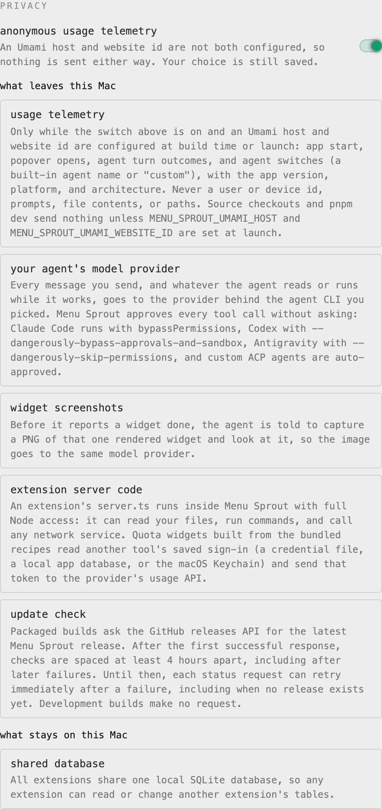
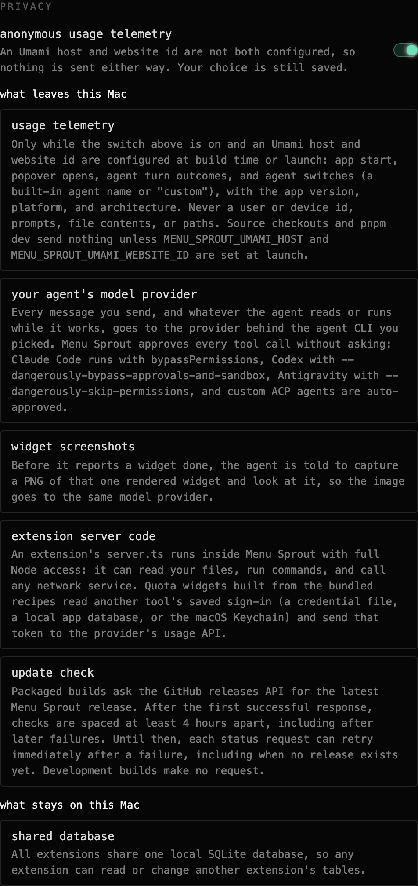

# Privacy

Menu Sprout runs on your own Mac, but some data does leave it.
This page lists every flow, and it matches the **privacy** section in Settings, which is where you can check and change the one switch Menu Sprout owns.

| Light | Dark |
| ----- | ---- |
|  |  |

## Usage telemetry

Builds with a self-hosted [Umami](https://umami.is) host and website id configured at build time or launch send anonymous, best-effort usage events, and they are on by default there.
Source checkouts and `pnpm dev` send nothing unless `MENU_SPROUT_UMAMI_HOST` and `MENU_SPROUT_UMAMI_WEBSITE_ID` are set at launch.
Any build without a configured Umami host and website id sends nothing.
There is no built-in default endpoint.

- **Sent:** app start, popover opens (a `/popover` page view plus a named event), agent turn outcomes (success, error, timeout, cancelled, stopped at a Settings turn limit, or blocked by a dirty workspace), and agent switches. Each event carries the app version, platform, and CPU architecture. Built-in agents are named `claude`, `codex`, or `antigravity`; custom agents report only as `custom`.
- **Never sent:** a user or device id, prompts, generated code, file contents, extension data, or local paths.
- Network failures are ignored and never affect the app.

### Turning it off

Open Settings and flip **anonymous usage telemetry** off.
The choice is saved in `preferences.json` (under `~/.menu-sprout` in the packaged app) and applies to the next event, without a restart.

Operators can also launch with `MENU_SPROUT_TELEMETRY=0` (`false` and `off` also work).
Precedence, highest first:

1. The saved Settings switch, once you have flipped it.
2. `MENU_SPROUT_TELEMETRY=0` in the launch environment.
3. On by default.

So the environment variable opts out only while no Settings choice is saved, and Settings tells you when it is the reason telemetry is off.

## Your agent's model provider

The embedded agent is a CLI you installed and signed in to (Claude Code, Codex, Antigravity, or a custom ACP agent).
Every message you send, and whatever the agent reads or runs while it works, goes to that agent's provider under that provider's own terms.

Menu Sprout approves every tool call without asking.
The ACP runtime runs with `approve-all`, and the bundled adapters launch Claude Code with `--permission-mode bypassPermissions`, Codex with `--dangerously-bypass-approvals-and-sandbox`, and Antigravity with `--dangerously-skip-permissions`.
The agent starts in the extension workspace, but its tools are not sandboxed to it.
What makes an agent turn reversible is the Keep / Undo change session over the extension workspace, not a permission prompt.

## Widget screenshots

Before the agent reports a widget done, Menu Sprout's prompt tells it to capture a PNG of that one rendered widget from a token-protected loopback endpoint and look at it.
Opening that image sends it to the same model provider.
Captures are saved in the app cache (`~/.menu-sprout/cache/captures` in the packaged app), outside the extension workspace.

## Extension server code

An extension's `server.ts` runs in Menu Sprout's main process with full Node access: it can read your files, run commands, and call any network service.
Only normalized, non-secret data is meant to cross into the popover, but nothing stops server code you keep from sending data elsewhere, so review what an agent writes before you keep it.

The bundled quota recipes, used only when you ask for a quota widget, have the agent build server code that reads another tool's saved sign-in (for example `~/.claude/.credentials.json`, `~/.codex/auth.json`, Cursor's local database, or the macOS Keychain) and sends that token to the provider's own usage API.

## Update check

Packaged builds ask `api.github.com` for the latest release of `shin315/menu-sprout`, with a generic `menu-sprout` user agent.
After the first successful response, checks are spaced at least four hours apart, including after later failures.
Until that first success, each status request can retry immediately after a failure, including when no release exists yet.
Development builds make no request.

## What stays on this Mac

- In the packaged app, extensions, preferences, agent sessions, caches, and the database live under `~/.menu-sprout`, never in the app bundle.
- All extensions share one SQLite database, so any extension can read or change another extension's tables.

## Reporting a problem

Report a privacy or security issue through [SECURITY.md](SECURITY.md).
