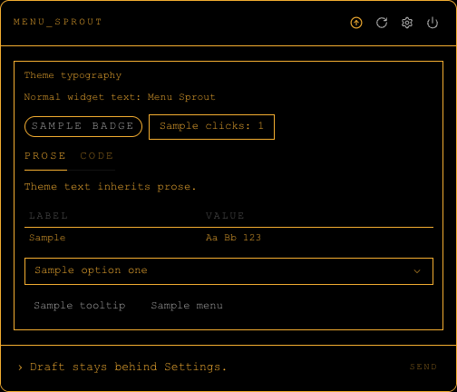
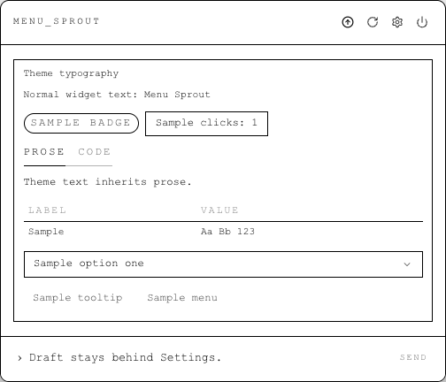
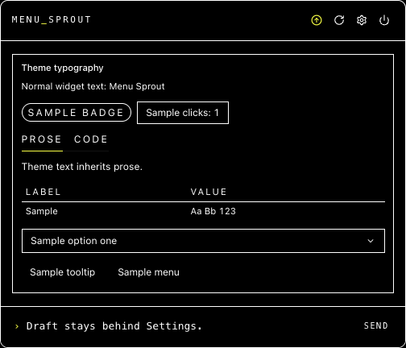
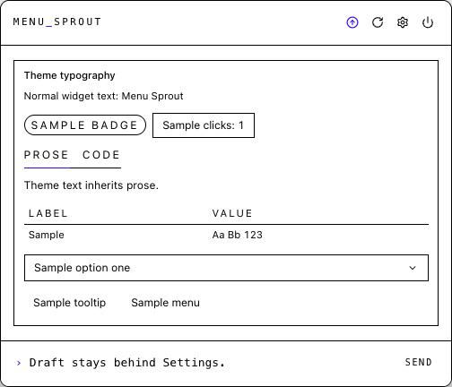
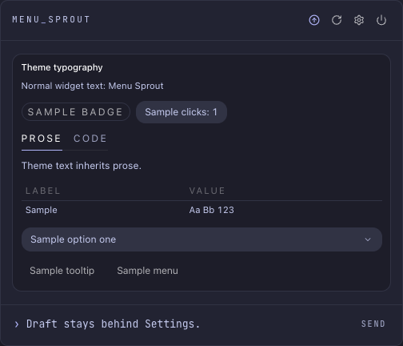
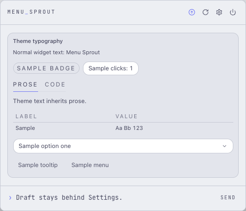

<h1 align="center">menu-sprout</h1>
<p align="center">
  <a href="https://github.com/shin315/menu-sprout/actions/workflows/ci.yml"></a>
  <a href="https://img.shields.io/badge/platform-macOS-blue?style=flat-square"></a>
  <a href="https://img.shields.io/badge/electron-42-9feaf9?style=flat-square"></a>
</p>

<h3 align="center">A developer-first menu bar you can talk to.</h3>

Menu Sprout is an open-source macOS menu-bar app where an embedded agent writes and hot-reloads your widgets live.

Instead of waiting for developers to build the perfect combination of tools for your workflow or downloading separate apps for CPU monitoring, calendar, and quotas, you describe what you want, and your chosen coding agent generates it on the spot.

- **Design by conversation** - chat directly in the popover to add or change menu items.
- **Safe iteration** - each modification acts as a self-contained transaction. The UI highlights actual diffs, letting you keep or roll back the results immediately.
- **Bring your own agent** - Menu Sprout drives Claude Code, Codex, or Antigravity, whichever you already have signed in.

## Features

- **Themes**: Choose a look in Settings; see the [theme previews](#themes).
- **Live Menu-Bar Items**: Widgets can show their own live text and icon directly in the macOS menu bar, not just inside the popover.
- **Supported Agents**: Built-in support for Claude Code, Codex, and Antigravity (`agy`).
- **Agent Visual Self-Check**: The embedded agent is prompted to capture and inspect its rendered widget before reporting done, checking layout, clipping, and empty or error states. See [visual self-check](docs/architecture.md#visual-self-check).
- **Vietnamese Recipes**: Built-in data recipes for SJC gold prices, Vietcombank VND exchange rates, and a Vietnamese lunar calendar.

## Themes

Theme fonts are bundled, so typography works offline without Google Fonts requests.
See the [font notices](src/renderer/fonts/README.md) for provenance and licenses.

More themes are available in [Settings](docs/configuration.md#choosing-a-theme). A few examples in dark and light mode:

| Theme | Dark | Light |
| --- | --- | --- |
| Retro Terminal |  |  |
| High Contrast |  |  |
| Calm Pastel |  |  |

## Status

Menu Sprout is pre-release.
It has its own app name, bundle identifier (`io.github.shin315.menusprout`), and data directory (`~/.menu-sprout`).
See [Features](#features) for the current feature overview.

## Quick Start

Requires macOS 13 Ventura or newer, Node.js 22.12 or newer, pnpm, and a supported, already-authenticated agent CLI on `PATH`: `claude` (Claude Code), `codex`, or `agy` (Antigravity).
There are no published releases yet, so run Menu Sprout from source:

```sh
git clone https://github.com/shin315/menu-sprout.git
cd menu-sprout
pnpm install
pnpm dev
```

See [docs/development.md](docs/development.md) for packaging a local `Menu Sprout Dev.app`.

Click the tray icon, then ask for a widget in the composer such as:

```text
add a CPU usage widget that shows current load in %
```

Menu Sprout writes changes to its extension workspace (`extensions-dev/` in the checkout when running `pnpm dev`, `~/.menu-sprout/extensions` in the packaged app), mounts updated widgets or layouts live, and shows a Keep / Undo bar only when files actually changed.
The bar labels the real diff (`Added the cpu extension`, `Updated the layout`) so you can keep or throw away each turn.
While the agent works, Cancel on the run strip stops the turn; any partial changes stay in the Keep / Undo bar.
After a turn, the agent's final reply appears above the composer, collapsed to two lines; only the latest reply is shown, never a transcript.
Below it, one line shows the turn's measured duration, tool calls, and tokens when the agent reported them.

Open the popover header to start a new agent conversation, reload the layout, reach Settings (an overlay that preserves your menu state), quit, or open the release page for an update.
Reloading the layout remounts the widget canvas and root layout while preserving the agent conversation and Settings state.
A widget that throws while rendering shows a compact error card in its slot instead of blanking the popover, so the header and Keep / Undo stay usable; right-click the tray icon for Open, Reload, and Quit, which work even when the popover itself is broken or hung.
Settings lets you pick the embedded agent and the [UI theme](docs/configuration.md#choosing-a-theme), choose each built-in agent's [model and effort and optional turn limits](docs/configuration.md#model-effort-and-turn-limits), manage custom ACP agents, turn anonymous telemetry off, see what data leaves your Mac, and, in the packaged app, toggle launch-at-login.

## Install Details

The packaged app stores extensions, the local database, caches, agent sessions, and preferences under `~/.menu-sprout`, so upgrades preserve user-created widgets and extension state. Menu Sprout refreshes its provider-neutral managed defaults from the release on each launch.
If `~/.menu-sprout/extensions` is a symlink, Menu Sprout seeds bundled defaults and compiles widget or layout CSS from the resolved writable target while leaving the symlink itself in place.

When a newer GitHub release of `shin315/menu-sprout` exists, Menu Sprout shows an update indicator in the popover header that links to the release page.

For theme and agent selection, custom ACP agents, telemetry, and environment flags, see [docs/configuration.md](docs/configuration.md).

## How It Works

```
   ┌─────────────────────┐
   │  macOS tray popover │   (React renderer, adaptive size)
   │ + Menu / Settings   │
   │ + Reload layout     │
   │ + Update / Quit     │
   └──────────┬──────────┘
              │  send()
              ▼
   ┌───────────────────────┐       ┌──────────────────────┐
   │  MenuSproutAgentRuntime ├──────►│    Change Session    │
   │   wraps acpx/runtime  │       │   git or snapshot    │
   └──────────┬────────────┘       │   by runtime mode    │
              │                    └──────────┬───────────┘
              │ edits files                   │ save / rollback
              ▼                               ▼
   ┌─────────────────────┐       ┌──────────────────────┐
   │ active extensions/  │       │   save snapshot or   │
   │  layout.tsx         │◄──────┤   rollback files     │
   │  <id>/widget.tsx    │       │   safely             │
   │  <id>/server.ts     │       │                      │
   └──────────┬──────────┘       │                      │
              │ hot-reload       └──────────────────────┘
              ▼
   ┌─────────────────────┐
   │     WidgetHost      │
   │ mounts layout/widget│
   └─────────────────────┘
```

- **Three processes, one bridge** - the renderer never touches git, the agent, or the filesystem; everything goes through `window.menuSprout`.
- **Recipes are specs, not prompts** - HTML files under `extensions/recipes/` describe a widget's capability and data sources; the agent reads the matching recipe before implementing.
  For live or system data, recipe guidance requires the agent to inspect the real source before parsing it and verify the finished widget against that same data before reporting done.
  The bundled quota recipes cover Claude Code, Codex, Cursor, GitHub Copilot, and Grok.
- **Bundled ACP adapters** - built-in Claude Code, Codex, and Antigravity run through clean-room adapters; Claude Code and Codex are isolated from user-level agent configuration.
- **Diff-derived Keep / Undo** - the change bar reflects the actual git or snapshot diff, not agent wording, and clears itself when nothing changed on disk.
- **Live menu-bar items** - a widget can show its own live text and icon directly in the macOS menu bar (one item per widget; clicking it opens the popover under the item). Items follow the widget: removing it or undoing the agent turn removes the item. See [docs/architecture.md](docs/architecture.md#extensions).
- **Extensions own their capabilities** - widgets, layouts, settings sections, server actions, background tasks, and a shared SQLite store, all behind the stable bridge.

For the full design notes and repository layout, see [docs/architecture.md](docs/architecture.md).

## Docs

- [docs/configuration.md](docs/configuration.md) - theme and agent selection, custom ACP agents, telemetry, environment flags
- [docs/architecture.md](docs/architecture.md) - runtime design notes and repository layout
- [docs/development.md](docs/development.md) - building, testing, and packaging Menu Sprout itself
- [docs/recipes.md](docs/recipes.md) - conventions for authoring bundled recipes
- [PRIVACY.md](PRIVACY.md) - what data leaves your Mac and how to turn telemetry off
- [SECURITY.md](SECURITY.md) - reporting vulnerabilities through GitHub private advisories

## License

Menu Sprout is released under the MIT License.
See [LICENSE](LICENSE) for details.
Bundled fonts have separate licenses; see the [font notices](src/renderer/fonts/README.md).

## Credits

Menu Sprout started as a fork of [kunchenguid/baby-menu](https://github.com/kunchenguid/baby-menu) by Kun Chen, MIT.
